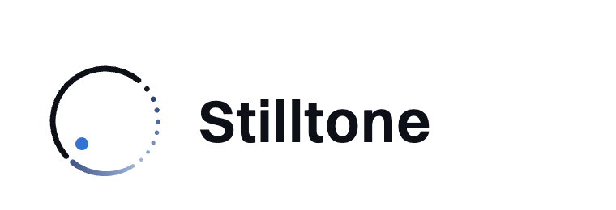

  <picture>
    <source media="(prefers-color-scheme: dark)" srcset="assets/lockup-dark.png">
    
  </picture>

<b>Private AI meeting notes for Mac.</b> 
No bot in your calls. Transcripts, notes and memory made on your Mac. Plain files you own.

<a href="https://stilltone.app">stilltone.app</a> · <a href="mailto:support@stilltone.app">support@stilltone.app</a>

---

Stilltone records your calls without a bot, writes a live transcript and the notes on your Mac, and keeps a memory
across meetings: decisions (and what later replaced them), action items that stay open until they're done, and what
changed since last time. Every item links to the moment it was said.

- **No bot.** Records your Mac's audio and your microphone, so it works with any call app and nobody new joins the meeting.
- **On your Mac.** Speech recognition, notes and memory run on-device. Once the models are downloaded, it works offline. No account.
- **Live, in 28 languages.** A streaming transcript as people speak, then a more accurate pass after the call (about 100 languages).
- **Memory across meetings.** A running record per project, person or recurring meeting that each new meeting updates.
- **Plain files.** Every meeting is a folder of Markdown and JSON. Obsidian export with frontmatter, tasks and backlinks.
- **Works with AI apps.** A local MCP server with 21 tools for Claude, Cursor and other MCP clients.

### Open-source companions

| Repository | What it is |
|---|---|
| [**obsidian-templates**](https://github.com/stilltone-app/obsidian-templates) | Free meeting templates for Obsidian, with Dataview roll-ups of every decision and open action item across your notes. Works with or without Stilltone. |
| [**mcp-examples**](https://github.com/stilltone-app/mcp-examples) | Ready-to-use setup for Claude Desktop, Claude Code and Cursor, the full tool reference and a prompt library. |

macOS 15 or later on Apple silicon · Free, with Pro as a one-time purchase · <a href="https://stilltone.app">stilltone.app</a>
